# QuickyAndroid

Unofficial Android app for QCY earbuds, built with Kotlin + Jetpack Compose (Material 3 Expressive). Communicates directly with the earbuds over BLE GATT using protocols reverse-engineered from the official QCY app.

## Screenshots

Captured on an Android 36 emulator with the bundled **QCY MeloBuds Pro** catalog entry (no hardware attached):

| | |
|---|---|
| **Dashboard** | **Noise Control** |
| 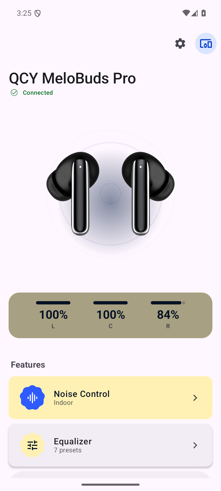 | 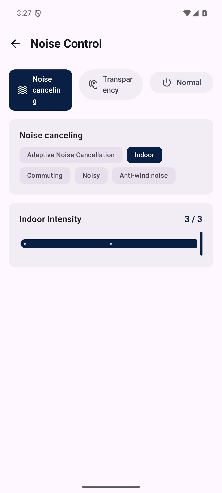 |
| **Transparency mode** | **Equalizer — Simple** |
| 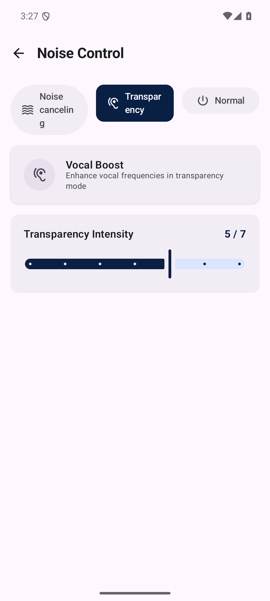 | 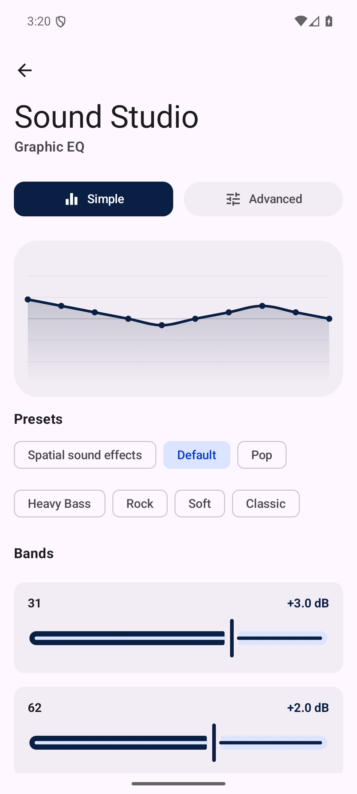 |
| **Equalizer — Advanced** | **Ear Tip Fit** |
| 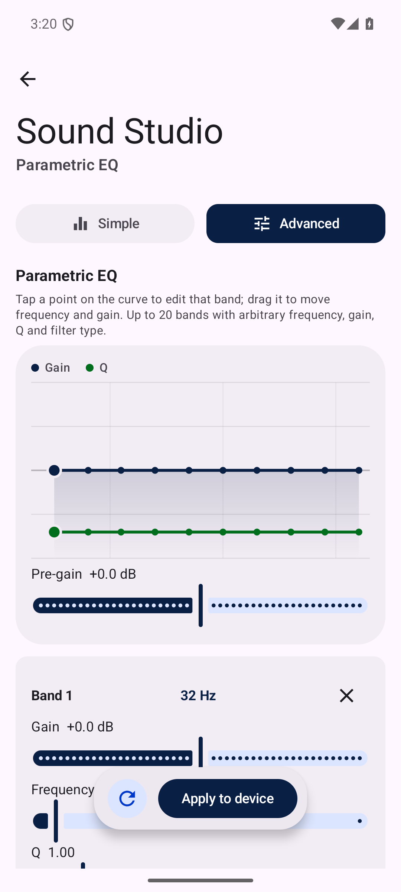 | 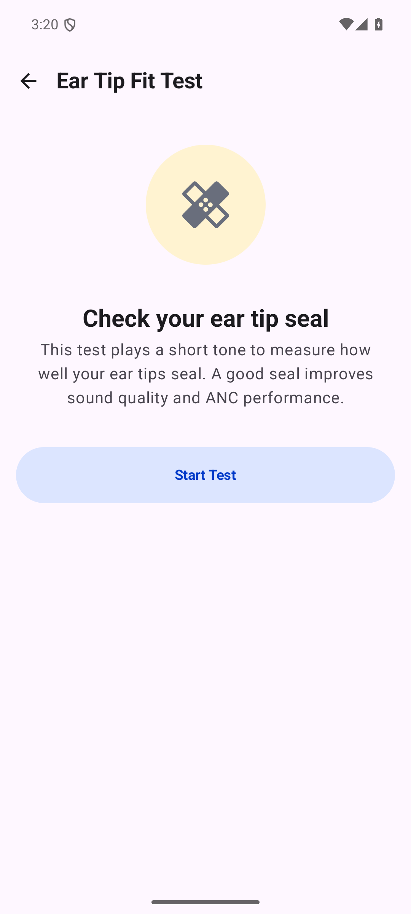 |
| **Key Controls** | **Find My Earphone** |
| 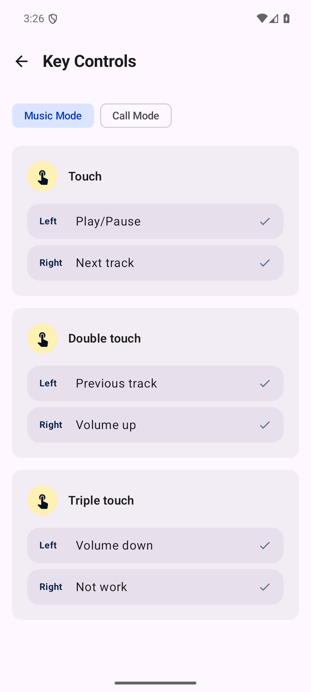 | 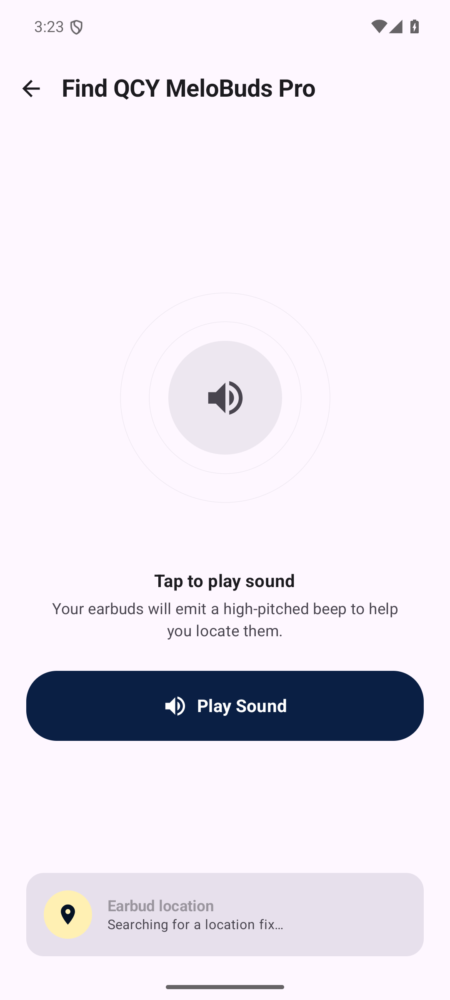 |
| **Device Settings** | **App Settings** |
| 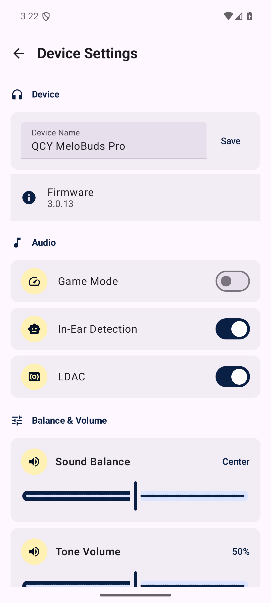 | 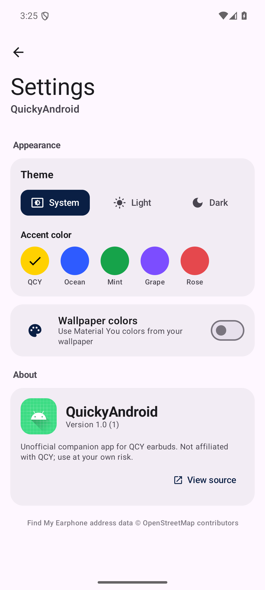 |
| **Devices** | |
| 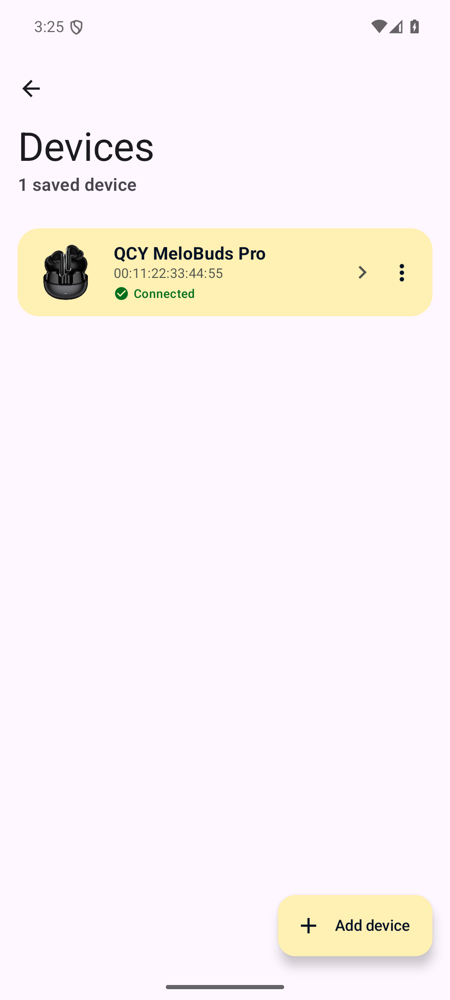 | |

## What it does

- **Saved devices** — the last used earbuds are remembered: the app opens on their dashboard and reconnects automatically. Multiple pairs are kept in a **Devices** screen (top-bar icon), where you can switch, forget, or add another pair. Pairing lives in the Devices screen instead of being the app's home screen.
- **Scan & connect** — BLE scan with advertisement parsing (battery levels/charging state per bud and case, product identification), then GATT connection. A foreground service (`BleService`, `connectedDevice` type) keeps the link alive, with auto-reconnect and battery polling.
- **Vendor protocol routing** — earbuds are routed by vendor ID to the right GATT client, mirroring the original app's chip-family detection (`VendorRouter`):
  - `STANDARD` — QCY service `0xA001` (QCC, WQ, Airoha, RTK, BES families)
  - `JL` / `JL_NEW` — JieLi chips via RCSP tunnel
  - `ZR` — Zhurui family
  - `WUQI` — runtime fallback for devices exposing only service `0x7033`
- **Device dashboard** — feature availability is derived from a bundled per-product catalog (`app/src/main/assets/android_products.json`, ~199 products with images):
  - Noise Control (ANC modes)
  - Equalizer (presets + custom multi-band, e.g. 10-band)
  - **Custom Parametric EQ** — up to 20 bands with arbitrary frequency,
    gain, Q and filter type (low-shelf / tilt / peaking / high-pass /
    low-pass) plus pre-gain, written via DataBean cmd `0x22` with the
    custom preset type. The firmware accepts far more than the fixed
    presets the retail app ships (firmware “custom-band unlock”,
    `catalog/EQ_PROTOCOL.md`); the section appears for standard-protocol
    connections and can read the live curve back (`0xFE 0x22`).
  - Game Mode, Spatial Audio, LDAC, Adaptive EQ, Env Adaptation, Focus/Sleep Mode
  - Per-bud volume (L/R), LED indicator, LED effects
  - Wearing detection, Ear Tip Fit test
  - Remote camera shutter
  - Key Controls — remap touch gestures per event
  - Find My Earphone — make a lost bud ring (animated pulse), OpenStreetMap-reverse-geocoded last location with a tap-to-open map action; the screen is reachable while disconnected and offers a Connect action
  - Device Settings — product-specific toggles
- **Hidden firmware features** (from the HT18 firmware RE workspace
  `/data/reversing/qcy-ht18`):
  - **Hearing Protection** toggle — WuQi sound cmds `0x20`/`0x22` (prefixes
    `A1 5A`/`A1 F9`), parsed by the firmware but absent from the retail
    control panel. Surfaced in Device Settings whenever the device exposes
    the `0x7033`/`0x2001` diagnostics channel (WQ-family firmware registers
    it alongside the standard service; the standard client attaches to it
    opportunistically).
  - Spatial-audio state is now also read back over that channel (`A1 59`),
    where the DataBean `0xFE` sub-read is rejected by the firmware.
  - Additional firmware-verified `0xFE` reads on connect/screen-refresh
    (`0x17` ANC setting, `0x24` dual-device, `0x2A` wind noise, `0x46`/`0x47`
    per-side EQ).
  - **Developer console** — raw sender for any of the 38 firmware sound
    commands (ID → prefix table in `WuqiSoundProtocol`), with live response
    logging on `0x2002`.
- **Home-screen widgets** — two independent widgets, both with a per-widget device binding chosen when they are placed:
  - **Quicky Battery** — connection state plus L/R/case levels (falls back to the last known levels when disconnected).
  - **Quicky ANC** — Off / ANC / Transparency chips. Switches through the live connection when the app process is around, or through a short-lived `AncWidgetService` GATT link when it is not; non-standard chip families fall back to opening the app.
- **Theming** — dark mode, dynamic color (Material You), M3 motion, Lottie animations, shared-element transitions between scan and dashboard.

## Requirements

- Android 8.0+ (minSdk 26), BLE hardware
- Bluetooth and notification runtime permissions (requested on first launch)

## Building

```bash
./gradlew assembleDebug          # debug APK
./gradlew testDebugUnitTest      # protocol/parser/router unit tests
./gradlew connectedDebugAndroidTest  # Compose instrumentation tests
```

## Layout

| Path | Contents |
|---|---|
| `app/src/main/java/com/hui1601/quickyandroid/ble/` | Scanner, foreground service, vendor GATT clients, protocol codecs |
| `app/src/main/java/com/hui1601/quickyandroid/ui/` | Compose screens, components, theme, view models |
| `app/src/main/java/com/hui1601/quickyandroid/data/` | Advertisement parser, product repository/models |
| `app/src/main/assets/` | Product catalog JSON + product images + Lottie animations |

## Disclaimer

**This is AI slop code.** It was generated largely by AI coding agents with minimal human review, and it talks to consumer hardware over undocumented, reverse-engineered protocols.

The code quality is a total mess. I don't care — it's AI slop.

The author accepts **no liability** for anything this app does or fails to do — bricked earbuds, drained batteries, missed alarms, or anything else — and claims **no rights** regarding its functionality.

Active maintenance happens **only while the author is actively using their QCY HT18 earbuds**. Once those earbuds are gone, this project is effectively abandoned: issues and pull requests may sit unaddressed indefinitely.
